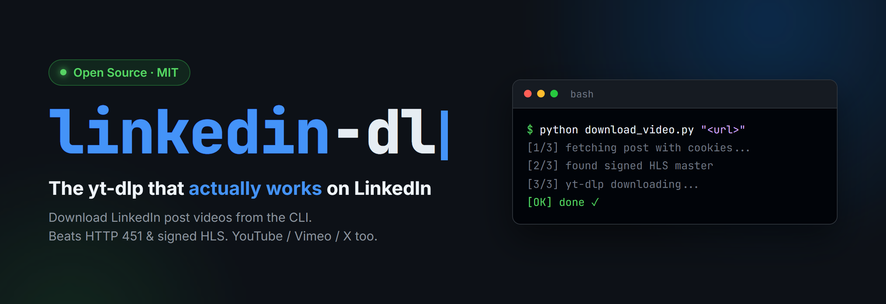

<p align="center">
  
</p>

<p align="center">
  <a href="https://github.com/Leon9407/linkedin-dl/stargazers"></a>
  <a href="LICENSE"></a>
  
  
  <a href="https://github.com/yt-dlp/yt-dlp"></a>
</p>

# linkedin-dl

**The `yt-dlp` that actually works on LinkedIn.** Download videos from LinkedIn
posts from the command line — and public videos (YouTube / Vimeo / Twitter·X)
through the same entry point.

LinkedIn makes this surprisingly hard: post pages return **HTTP 451** to anonymous
requests, and videos are served only as **signed, expiring HLS streams** (no plain
MP4). A bare `yt-dlp <linkedin-url>` therefore fails. This tool handles the two
pieces of state that make it work — a logged-in cookie jar and the fully-signed
playlist URL — so you can just hand it a link.

It is packaged as a [Claude Code](https://docs.claude.com/en/docs/claude-code)
**skill** (`SKILL.md`), but the scripts are plain Python and run standalone.

## Why plain yt-dlp isn't enough for LinkedIn

- Anonymous requests to a LinkedIn post get **HTTP 451** (Unavailable For Legal Reasons) — you need login cookies.
- You **can't** read your main browser's cookie database while the browser is running (it holds an exclusive OS lock), and decrypting it is fragile and security-sensitive.
- LinkedIn exposes **no progressive MP4**, only HLS. The master-playlist URL is signed in its query string (`e=<expiry>&v=beta&t=<token>`); drop any parameter and the CDN returns **403**.
- The CDN (`dms.licdn.com`) also rejects requests without a `linkedin.com` **Referer**.

This tool solves each of these.

## How it works

1. **`scripts/export_cookies.py`** launches a *dedicated* Microsoft Edge instance
   with its own profile directory (it coexists with your normal browser — nothing
   to close, no main profile touched). You log in once; cookies are read straight
   from the browser context (no file lock, no decryption) and written to
   `linkedin_cookies.txt`. The profile persists, so later runs usually export
   with no interaction.
2. **`scripts/download_video.py`** fetches the post HTML with those cookies,
   extracts the fully-signed HLS master URL, and hands it to `yt-dlp` with the
   right `Referer`/`Origin` headers to download and mux the best quality.

For non-LinkedIn URLs, `download_video.py` skips all of the above and calls
`yt-dlp` directly — one entry point for every site.

## Requirements

- **Python 3.9+**
- **[yt-dlp](https://github.com/yt-dlp/yt-dlp)** and **[ffmpeg](https://ffmpeg.org/)** on `PATH` (ffmpeg is needed to mux HLS)
- **[Playwright](https://playwright.dev/python/)** (`pip install playwright && playwright install chromium`) — only for the one-time cookie export
- **Microsoft Edge** (Windows). The Edge path in `export_cookies.py` assumes the standard install location.

```bash
python -m pip install -U yt-dlp playwright
playwright install chromium
```

## Usage

```bash
# 1) One-time: log in and export cookies (opens a dedicated Edge window)
python scripts/export_cookies.py

# 2) Download a LinkedIn post video
python scripts/download_video.py "https://www.linkedin.com/feed/update/urn:li:activity:XXXXXXXXXXXXXXXXXXX/" \
    --out ./downloads --name my_clip

# Public sites need no cookies — same command, routed straight to yt-dlp
python scripts/download_video.py "https://www.youtube.com/watch?v=XXXXXXXXXXX" --out ./downloads
```

**Options**

| Flag        | Meaning                                              | Default                     |
|-------------|------------------------------------------------------|-----------------------------|
| `--out`     | Output directory                                     | `~/Downloads/linkedin-videos` |
| `--name`    | Output base name (no extension)                      | video title / `linkedin_video` |
| `--cookies` | Path to a Netscape `cookies.txt`                     | `../linkedin_cookies.txt`   |

Cookies expired? You'll see **451 / 401 / 403** — just re-run `export_cookies.py`.

## Troubleshooting

- **HTTP 451 / 401 when fetching the page** → cookies expired; re-run `export_cookies.py`.
- **HTTP 403 from dms.licdn.com** → the signed URL expired (they're short-lived); re-run `download_video.py` (it fetches a fresh signed URL each time).
- **"video playlist not found"** → the post may contain no video (image/article).
- **yt-dlp not found** → `python -m pip install -U yt-dlp` (invoked as `python -m yt_dlp`).
- **Public site (YouTube/Vimeo) times out** → likely a network/region block, not the tool. Set a proxy and the script passes it through:
  `export HTTPS_PROXY=http://127.0.0.1:<port>`.

## Security

`linkedin_cookies.txt` contains your **live LinkedIn session** — treat it like a
password. It is listed in `.gitignore` and must never be committed. The dedicated
Edge profile directory holds the same session and is git-ignored too.

## 中文说明

命令行下载 LinkedIn 帖子里的视频,公开视频(YouTube/Vimeo/Twitter·X)也走同一个入口。

LinkedIn 的难点:匿名访问帖子返回 **HTTP 451**,视频只以**带签名、会过期的 HLS 流**提供(没有直接的 MP4),所以直接 `yt-dlp` 会失败。本工具解决两件事——保存登录 cookies、拿到完整签名的播放列表地址。

**用法:**

```bash
# 第一步(一次性):登录并导出 cookies,会弹出一个独立的 Edge 窗口
python scripts/export_cookies.py

# 第二步:下载 LinkedIn 视频
python scripts/download_video.py "<LinkedIn 帖子链接>" --out ./downloads --name 我的视频

# 公开网站无需 cookies,同样的命令自动走 yt-dlp
python scripts/download_video.py "<YouTube 链接>" --out ./downloads
```

**原理:** 用一个独立 Edge profile 登录一次(和你平时的浏览器并存,不用关、不碰主 profile),从浏览器上下文直接读 cookies(不解密、不碰被锁的 cookie 库);再用 cookies 抓页面、解析出完整签名的 HLS 主播放列表,交给 yt-dlp 下载合并。

**安全提示:** `linkedin_cookies.txt` 等于你的登录态,相当于密码,已在 `.gitignore` 中,切勿提交到仓库。

## License

[MIT](LICENSE)

---

*This tool automates your own authenticated access to content you can already
view. Respect LinkedIn's Terms of Service and others' copyright — download only
what you have the right to.*
